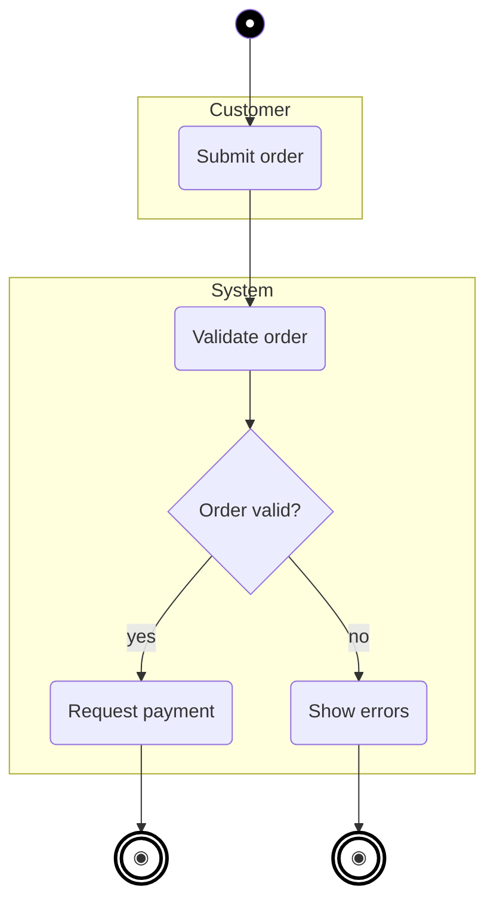

# Activity diagram (Mermaid)

One diagram per use case. Output file: `docs/uml/activity-<use-case-slug>.md` (format defined in `uml-agent`). Read `docs/uml/use-case.md` first and reuse its actor and use case names.

## Required inputs (ask via `ask-missing-info` if any is missing)

1. Which use case (ID from the catalog)
2. Trigger: what starts the flow
3. Main (happy) path steps in order
4. Decision points and every outcome, including error and alternate paths
5. Who performs each step (becomes swimlanes)
6. End states (success, failure, cancelled)

Parallel steps are optional. Ask only if the description hints at them.

## Mermaid mapping

Use `flowchart TD`:

| UML element | Mermaid |
|---|---|
| Start | `START(("●")):::startNode` |
| End | `FIN_OK((("◉"))):::endNode` |
| Action | `A1("Verb noun")` |
| Decision | `D1{"Question?"}` with edges `-->|"yes"|` and `-->|"no"|` |
| Fork / Join | `FORK1{{"Fork"}}` / `JOIN1{{"Join"}}` |
| Swimlane | `subgraph LANE_Name["Actor"]` containing that actor's actions |
| Sub-flow | `SUB1[["Sub-flow name"]]` |

## Template

## Rules

- Exactly one start, at least one end.
- Every decision has 2 or more outgoing edges, all labeled, covering all outcomes.
- Every non-end node has an outgoing edge. No dead ends.
- Action = verb + noun in business language. No technical steps (no "call API", "save to DB").
- Swimlane names must match actor names in the use case diagram.
- Aim for 20 nodes or fewer. Above that, extract a sub-flow into its own diagram and reference it with a `[[ ]]` node.
- Below the diagram, add one line: `Use case: <ID> <name>`.

## Done when

- [ ] All required inputs are answered or recorded as assumptions
- [ ] Happy path and every error/alternate path reach an end node
- [ ] Lane names and action nouns match the use case diagram
- [ ] File saved with `status: draft`, then approval is requested (return contract in `uml-agent`)
