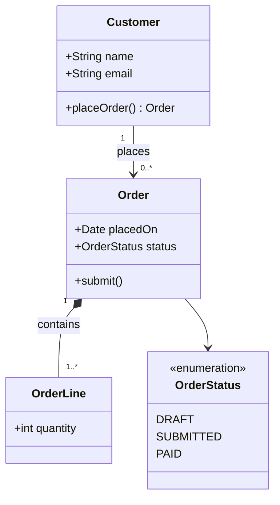

# Class diagram: domain model (Mermaid)

Output file: `docs/uml/class-model.md` (format defined in `uml-agent`). Read all files in `docs/uml/` first. Candidate classes are the nouns in use cases and activity steps.

## Level of detail

This is a **domain model**, not a database design. Keep it technology-neutral.

- Do: business attributes, relationships, multiplicities, enums, behavior that appears in activity steps.
- Do not: Spring/JPA annotations, foreign keys, join tables, surrogate IDs, column types, or normalization. Those belong to the ER diagram (keys, join entities, normalization) and the later schema phase.

## Required inputs (ask via `ask-missing-info` if any is missing)

1. Confirmed list of key entities (propose from the use case and activity files)
2. Key attributes per entity
3. Relationships with multiplicities (1, 0..1, 0..*, 1..*)
4. Ownership: which parts cannot exist without their whole (composition vs association)
5. Status or type values (enums) and any inheritance

## Mermaid mapping

Use `classDiagram`:

| UML element | Mermaid |
|---|---|
| Class | `class Order { +Date placedOn }` |
| Operation | `+submit()` or `+total() Money` |
| Enum | `class OrderStatus { <<enumeration>> DRAFT SUBMITTED }` |
| Interface | `<<interface>>` inside the class body |
| Inheritance | `Parent <\|-- Child` |
| Composition | `Whole "1" *-- "1..*" Part : contains` |
| Aggregation | `Group "1" o-- "0..*" Member : has` |
| Association | `A "1" --> "0..*" B : verb` |
| Dependency | `A ..> B : uses` |

## Template

## Rules

- Class names: PascalCase, singular nouns. Relationship labels: verbs.
- Every class connects to something (an enum may connect only through an attribute type).
- Every important noun in the activity diagrams appears here, and every class is used by some activity or use case.
- Every operation maps to an activity step.
- Aim for 15 classes or fewer per diagram. Above that, split into several diagrams by area.

## Flags for the ER diagram

Below the diagram, add a short `## Flags for the ER diagram` list. Flags only, no solutions:

- Entities that look like they hold personal, financial, or otherwise sensitive data
- Many-to-many relationships (each needs a join entity in the ER diagram)
- Status enums and lifecycle rules

## Done when

- [ ] All required inputs are answered or recorded as assumptions
- [ ] Names match the use case and activity diagrams exactly
- [ ] No database or framework details leaked in
- [ ] Flags for the ER diagram listed
- [ ] File saved with `status: draft`, then approval is requested (return contract in `uml-agent`)
