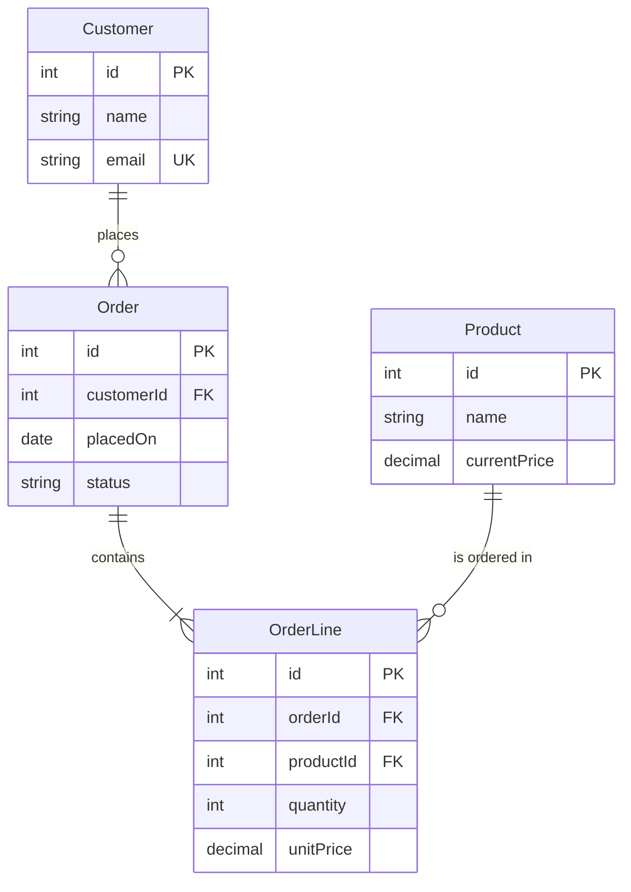

# ER diagram: logical data model (Mermaid)

Output file: `docs/uml/er-diagram.md` (format defined in `uml-agent`). Read `docs/uml/class-model.md` first, plus the use case and activity files for business rules.

## Level of detail

This is the **logical** model: engine-neutral and normalized to 3NF (BCNF where it costs nothing).

- Do: entities, attributes with logical types, PK/FK/UK marks, cardinalities, join entities.
- Do not: engine-specific types, indexes, DDL, partitioning, denormalization, or table/column naming conventions. Those belong to the later schema phase.

Logical types: `string`, `text`, `int`, `decimal`, `boolean`, `date`, `datetime`.

## Required inputs (ask via `ask-missing-info` if any is missing)

1. Identity: what makes a row unique for each entity (natural key or surrogate key)
2. Business rules that act as functional dependencies, for example "is an order line's price a snapshot or the current product price?"
3. Attributes that belong to a many-to-many relationship itself (they go on the join entity)
4. Inheritance strategy per hierarchy: one entity, entity per class, or shared base entity
5. Optionality: which relationships are mandatory and which are optional
6. Enums: keep as an attribute with allowed values, or a lookup entity (when values change as data or carry attributes)

## Class model to ER

- Class becomes an entity. Operations are dropped.
- Association 1..* puts an FK on the "many" side. 0..1 means optional FK, 1 means mandatory FK.
- Many-to-many becomes a join entity with two FKs, plus any relationship attributes. Prefer a domain name for it (`OrderLine`) over `A_B`.
- Composition becomes a child entity with an FK to the parent, drawn as an identifying relationship (`--`).
- Inheritance follows the strategy chosen in input 4.
- Enum follows the choice in input 6.

## Mermaid mapping

Use `erDiagram`:

- Entity: `Customer { string name }`. Keep names identical to the class names.
- Attribute: `type name` followed by optional `PK`, `FK`, or `UK`.
- Relationship: `A <left><line><right> B : "label"`.
- Left/right cardinality symbols: `||` exactly one, `|o` or `o|` zero or one, `}o` or `o{` zero or more, `}|` or `|{` one or more.
- Line: `--` identifying (child cannot exist without parent), `..` non-identifying.
- Quote a relationship label that contains spaces.

## Template

## Normalization checks

- **1NF:** no list-valued attributes. Split them into a child entity.
- **2NF:** in entities with a composite key, no attribute depends on only part of the key.
- **3NF:** no non-key attribute depends on another non-key attribute. Move it out, or record the reason it stays.
- Derived values (totals, counts) are not stored. Flag them if performance might need them.
- Record every non-obvious decision in Assumptions with the dependency stated, for example: "A3: OrderLine.unitPrice is a snapshot of the price at order time, so it is stored on OrderLine and not derived from Product.currentPrice."

## Rules

- Every entity has a PK. Every FK matches exactly one relationship line, and every relationship line has its FK.
- Entity names match class names. Every non-enum class has an entity or is listed in Assumptions as intentionally dropped. Every entity traces to a class or is a join entity.
- Aim for 15 entities or fewer per diagram. Above that, split by area.

## Flags for the schema phase

Below the diagram, add a short `## Flags for the schema phase` list. Flags only, no solutions:

- Entities likely to be large or heavily queried
- Candidate denormalization spots, each with the reason
- Attributes holding personal, financial, or credential data
- Soft-delete, audit trail, or history needs
- Enums that may become lookup tables

## Done when

- [ ] All required inputs are answered or recorded as assumptions
- [ ] Every entity has a PK, and FKs match relationship lines
- [ ] 1NF, 2NF, and 3NF checks pass, or each exception is recorded
- [ ] Names match the class model exactly
- [ ] Flags for the schema phase listed
- [ ] File saved with `status: draft`, then approval is requested (return contract in `uml-agent`)
