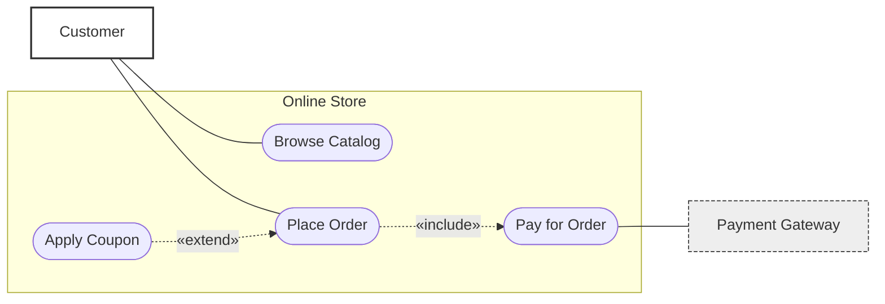

# Use Case diagram (Mermaid)

Output file: `docs/uml/use-case.md` (format defined in `uml-agent`).

## Required inputs (ask via `ask-missing-info` if any is missing)

1. System name and one-line purpose
2. Actors: human roles and external systems
3. Goal of each actor (what they want to achieve)
4. System boundary: what is in scope and out of scope
5. Scope level: MVP only or full feature set

Include/extend relations are optional. Infer them, then confirm in Assumptions.

## Mermaid mapping

Mermaid has no native use case diagram, so use a `flowchart LR` with these conventions:

| UML element | Mermaid |
|---|---|
| Actor (human) | `ACT_Name["Name"]:::actor` |
| Actor (external system) | `ACT_Name["Name"]:::system` |
| Use case | `UC_Name(["Verb Noun"])` |
| System boundary | `subgraph SYS["System Name"]` |
| Association | `---` |
| Include | `UC_A -.->|"«include»"| UC_B` (A needs B) |
| Extend | `UC_X -.->|"«extend»"| UC_A` (X optionally adds to A) |
| Actor specialization | `ACT_Child -->|"is a"| ACT_Parent` |

Primary actors go on the left, external system actors on the right.

## Template

## Rules

- Actor = a role, not a person. Use case = verb + noun, a user goal, not a UI step or technical action.
- Every actor has at least one use case. Every use case has at least one actor, or is included/extended by one that does.
- No data flows or sequence. Arrows show participation only.
- Aim for 5 to 25 use cases. Above 25, group them in nested subgraphs by area.
- Below the diagram, add a catalog table (the activity skill reads it):

| ID | Use case | Primary actor | Goal (one line) |
|---|---|---|---|

## Done when

- [ ] All 5 required inputs are answered or recorded as assumptions
- [ ] No orphan actors or use cases
- [ ] Names are consistent and unambiguous
- [ ] Catalog table matches the diagram
- [ ] File saved with `status: draft`, then approval is requested (return contract in `uml-agent`)
